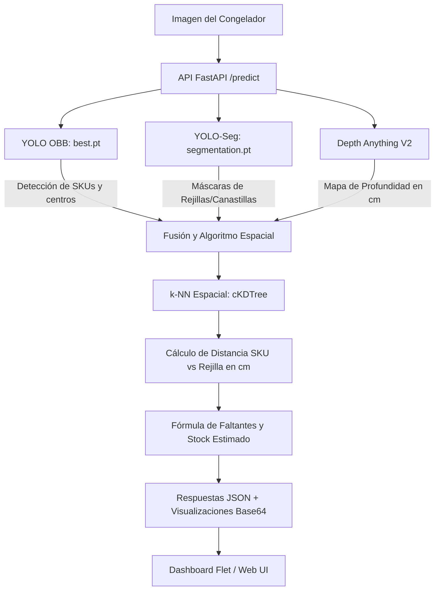

# 🍦 SealCreamAI

Sistema integral de visión por computadora e inteligencia artificial diseñado para la **auditoría y control de inventario en tiempo real** en congeladores comerciales de helados (marcas Holanda / Unilever como Magnum, Cornetto, Mordisko, Solero, etc.).

El sistema combina **tres modelos de IA simultáneos** para no solo contar los productos visibles, sino también estimar las unidades faltantes y el stock total en profundidad:
1. **Detección con Cajas Orientadas (YOLO OBB)**: Identifica y clasifica los helados en cualquier orientación o ángulo de inclinación dentro de las canastillas.
2. **Segmentación de Instancias (YOLO Segmentation)**: Segmenta con precisión las rejillas, canastillas y separadores metálicos del congelador.
3. **Estimación Métrica de Profundidad (Depth Anything V2)**: Genera un mapa de profundidad calibrado en centímetros (cm) para calcular la distancia física entre el producto frontal y el fondo/rejilla de referencia.

---

## 🏗️ Arquitectura del Repositorio

El repositorio está organizado de forma modular separando las fases de entrenamiento, inferencia y presentación visual:

```
Ultimate_Model_Ice/
├── app/                            # Capa de aplicación y servicio de inferencia
│   ├── backend/                    # Microservicio FastAPI y pipeline de visión por computadora
│   ├── app.py                      # Interfaz de escritorio interactiva construida en Flet (Python)
│   ├── index.html                  # Dashboard web responsivo con Tailwind CSS y Vanilla JS
│   ├── temp.py                     # Script utilitario de verificación de modelos
│   └── README.md                   # Documentación específica de la aplicación y dashboards
│
├── yolo_bouding_boxes_train/       # Pipeline de entrenamiento para cajas orientadas (OBB)
│   ├── entrenar.py                 # Script de entrenamiento YOLOv8n-OBB con aumentación defensiva
│   ├── wrapper.py                  # Pipeline de limpieza y desduplicación de imágenes por hash SHA-256
│   └── README.md                   # Documentación del entrenamiento OBB
│
├── yolo_segmentation_train/        # Pipeline de entrenamiento para segmentación de rejillas
│   ├── main.py                     # Script de entrenamiento YOLOv8n-Seg optimizado para varillas finas (1024px)
│   └── README.md                   # Documentación del entrenamiento de segmentación
│
└── README.md                       # Documentación principal del proyecto (este archivo)
```

---

## ⚙️ Flujo de Procesamiento (Pipeline de IA)



### 🧮 Lógica de Estimación de Inventario
1. **Mapeo a Centímetros**: La salida de `Depth Anything V2` se normaliza y proyecta a un rango físico calibrado (ej. 5 a 30 cm de profundidad).
2. **Asociación Espacial k-NN**: Para cada helado detectado, se buscan los $k=20$ píxeles más cercanos pertenecientes a la rejilla o canastilla más próxima usando árboles espaciales `cKDTree` de SciPy.
3. **Cálculo de Faltantes**:
   $$\text{diferencia\_cm} = |\text{profundidad\_sku} - \text{profundidad\_rejilla}|$$
   $$\text{faltantes} = \left\lfloor \frac{\text{diferencia\_cm}}{\text{paso\_cm}} \right\rceil$$
   $$\text{stock\_estimado} = \text{capacidad\_max} - \text{faltantes}$$

---

## 🚀 Guía Rápida de Inicio

### 1. Requisitos Previos
- Python 3.10 o superior.
- Tarjeta gráfica NVIDIA recomendada (CUDA 12.1) para inferencia acelerada.

### 2. Instalación de Dependencias
Instala los requerimientos en el entorno virtual del backend:
```bash
cd app/backend
pip install -r requirements.txt
```

### 3. Iniciar el Servidor de Inferencia (Backend)
```bash
cd app/backend
python main.py
```
El servidor quedará escuchando en `http://127.0.0.1:8000`. La documentación interactiva Swagger estará disponible en `http://127.0.0.1:8000/docs`.

### 4. Lanzar la Interfaz de Usuario
Puedes elegir entre la aplicación de escritorio o la web:

- **Opción A: App de Escritorio (Flet)**:
  ```bash
  cd app
  python app.py
  ```
- **Opción B: Dashboard Web (HTML/JS)**:
  Abre directamente `app/index.html` en tu navegador o sírvelo con cualquier servidor HTTP local (ej. Live Server o `python -m http.server 3000`).

---

## 📂 Enlaces a Módulos Específicos

- [Documentación del Módulo de Aplicación y UI](file:///c:/Users/luigu/OneDrive/Escritorio/Ultimate_Model_Ice/app/README.md)
- [Documentación del Backend y Motor de Profundidad](file:///c:/Users/luigu/OneDrive/Escritorio/Ultimate_Model_Ice/app/backend/README.md)
- [Documentación del Entrenamiento YOLO OBB](file:///c:/Users/luigu/OneDrive/Escritorio/Ultimate_Model_Ice/yolo_bouding_boxes_train/README.md)
- [Documentación del Entrenamiento YOLO Segmentation](file:///c:/Users/luigu/OneDrive/Escritorio/Ultimate_Model_Ice/yolo_segmentation_train/README.md)
