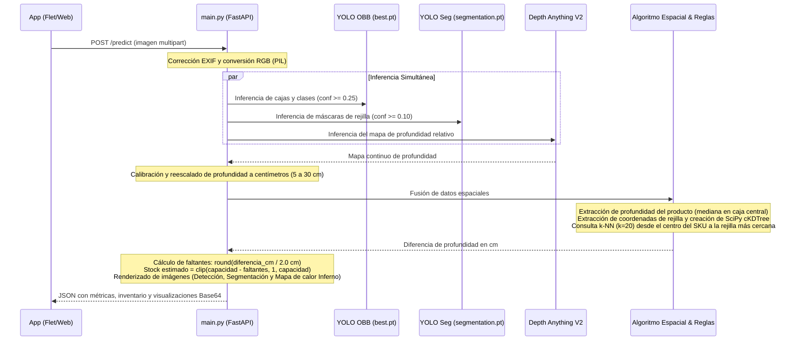

# 🧠 Backend de Inferencia y Visión Métrica (`app/backend/`)

Microservicio REST desarrollado con **FastAPI** encargado de orquestar el pipeline completo de visión por computadora: detección de productos con cajas orientadas, segmentación de rejillas, estimación de profundidad métrica en centímetros y cálculo matemático del inventario físico.

---

## 📋 Tabla de Contenidos
- [Arquitectura de Archivos](#-arquitectura-de-archivos)
- [Modelos Utilizados](#-modelos-utilizados)
- [Pipeline de Inferencia Paso a Paso](#-pipeline-de-inferencia-paso-a-paso)
- [Especificación del Endpoint (`/predict`)](#-especificación-del-endpoint-predict)
- [Configuración y Reglas de Negocio](#-configuración-y-reglas-de-negocio)
- [Instalación y Despliegue](#-instalación-y-despliegue)

---

## 🗂️ Arquitectura de Archivos

| Archivo | Rol en el Sistema |
| :--- | :--- |
| [`main.py`](file:///c:/Users/luigu/OneDrive/Escritorio/Ultimate_Model_Ice/app/backend/main.py) | Punto de entrada del servidor FastAPI, definición de rutas (`/predict`), orquestación del pipeline, generación de visualizaciones en Base64 y configuración de CORS. |
| [`models.py`](file:///c:/Users/luigu/OneDrive/Escritorio/Ultimate_Model_Ice/app/backend/models.py) | Inicialización y carga de los 3 modelos de IA (`best.pt`, `segmentation.pt` y `Depth-Anything-V2-Small-hf`), con detección automática de aceleración por GPU (CUDA / CPU). |
| [`depth_utils.py`](file:///c:/Users/luigu/OneDrive/Escritorio/Ultimate_Model_Ice/app/backend/depth_utils.py) | Módulo de procesamiento geométrico y profundidad: interpolación bicúbica, escalado físico a centímetros, extracción por mediana en Bounding Box y búsqueda espacial k-NN con `cKDTree`. |
| [`config.py`](file:///c:/Users/luigu/OneDrive/Escritorio/Ultimate_Model_Ice/app/backend/config.py) | Configuración de rutas de pesos, diccionario de capacidades máximas por SKU, paso físico en cm por unidad (2.0 cm) y palabras clave para identificar rejillas. |
| [`rules.py`](file:///c:/Users/luigu/OneDrive/Escritorio/Ultimate_Model_Ice/app/backend/rules.py) | Normalización de cadenas de texto y reglas heurísticas de capacidad y profundidad asociadas a los nombres de los productos. |
| [`best.pt`](file:///c:/Users/luigu/OneDrive/Escritorio/Ultimate_Model_Ice/app/backend/best.pt) | Pesos de red neuronal para el modelo **YOLOv8 OBB** (detección orientada de helados). |
| [`segmentation.pt`](file:///c:/Users/luigu/OneDrive/Escritorio/Ultimate_Model_Ice/app/backend/segmentation.pt) | Pesos de red neuronal para el modelo **YOLOv8 Seg** (segmentación de rejillas y canastillas). |
| [`requirements.txt`](file:///c:/Users/luigu/OneDrive/Escritorio/Ultimate_Model_Ice/app/backend/requirements.txt) | Especificación de librerías y versiones exactas de PyTorch, Ultralytics, Transformers, FastAPI, OpenCV y SciPy. |
| [`app.yaml`](file:///c:/Users/luigu/OneDrive/Escritorio/Ultimate_Model_Ice/app/backend/app.yaml) | Archivo de configuración para despliegues contenerizados o servicios en la nube. |
| [`readme_no.txt`](file:///c:/Users/luigu/OneDrive/Escritorio/Ultimate_Model_Ice/app/backend/readme_no.txt) | Notas técnicas originales de la arquitectura de backend. |

---

## 🤖 Modelos Utilizados

1. **Detección de Helados (YOLO OBB - `best.pt`)**:
   - Detecta productos orientados en cualquier ángulo dentro del congelador.
   - Retorna coordenadas de caja, centro $(cx, cy)$, confianza y clase (SKU: Magnum, Cornetto, Mordisko, Solero, etc.).

2. **Segmentación de Rejillas (YOLOv8-Seg - `segmentation.pt`)**:
   - Segmenta los alambres, barras y estructuras de las canastillas donde reposan los productos.
   - Genera una máscara binaria a resolución completa (`retina_masks=True`).

3. **Profundidad Métrica (Depth Anything V2 - `depth-anything/Depth-Anything-V2-Small-hf`)**:
   - Modelo de visión basado en transformadores (DINOv2) ejecutado mediante Hugging Face Transformers.
   - No requiere pesos locales adicionales (se descargan automáticamente por Hugging Face Hub en la primera ejecución).

---

## 🔄 Pipeline de Inferencia Paso a Paso



---

## 📡 Especificación del Endpoint (`/predict`)

### Petición
- **Método**: `POST`
- **Ruta**: `/predict`
- **Cabecera**: `Content-Type: multipart/form-data`
- **Cuerpo**: Campo `file` con el archivo binario de la imagen (`image/jpeg` o `image/png`).

### Ejemplo de Respuesta (`200 OK`)
```json
{
  "status": "success",
  "total_skus_detectados": 4,
  "total_rejillas_detectadas": 2,
  "detecciones": [
    {
      "etiqueta": "Magnum Clasica",
      "visibles": 2,
      "stock_estimado": 18
    },
    {
      "etiqueta": "Cornetto Fresa",
      "visibles": 2,
      "stock_estimado": 20
    }
  ],
  "detalle_detecciones": [
    {
      "id_deteccion": "det_1",
      "sku": "Magnum Clasica",
      "confianza": 0.892,
      "profundidad_sku": 12.4,
      "profundidad_rejilla": 18.6,
      "profundidad_texto": "12.4cm / 18.6cm",
      "diferencia_cm": 6.2,
      "capacidad_maxima": 12,
      "faltantes_calculados": 3,
      "inventario_estimado": 9,
      "estado": "estimado_exitoso"
    }
  ],
  "imagen_base64": "<cadena base64 de la imagen anotada con cajas>",
  "imagen_seg_base64": "<cadena base64 de las máscaras de segmentación>",
  "imagen_depth_base64": "<cadena base64 del mapa térmico INFERNO>"
}
```

---

## ⚙️ Configuración y Reglas de Negocio

En [`config.py`](file:///c:/Users/luigu/OneDrive/Escritorio/Ultimate_Model_Ice/app/backend/config.py) se definen los parámetros clave:

- **`PASO_PROFUNDIDAD_POR_SKU`**: Grosor físico asignado a cada unidad (por defecto `2.0 cm`). Cada 2 cm de separación entre la cara frontal y la canastilla representa una unidad vendida/faltante.
- **`REGLAS_CAPACIDAD_TEXTO`**: Capacidad total máxima cuando la canastilla está completamente llena (por defecto `12` unidades).
- **`REJILLA_KEYWORDS`**: Palabras reservadas para separar detecciones de rejillas de los helados (`"rejilla"`, `"canastilla"`, `"separador"`, `"carril"`, etc.).

---

## 🛠️ Instalación y Despliegue

### 1. Requisitos de Entorno
Se aconseja usar un entorno virtual de Python 3.10+:
```bash
python -m venv venv
venv\Scripts\activate
pip install -r requirements.txt
```

### 2. Ejecución Local en Desarrollo
```bash
uvicorn main:app --host 127.0.0.1 --port 8000 --reload
```
Acceso a la interfaz interactiva Swagger UI: `http://127.0.0.1:8000/docs`

### 3. Exposición Externa para Pruebas (ngrok)
Si requieres probar la aplicación web desde un dispositivo móvil o red externa:
```bash
ngrok http 8000
```
Copia la URL `https://xxxx.ngrok-free.app` y agrégale el sufijo `/predict` en el selector del frontend.
